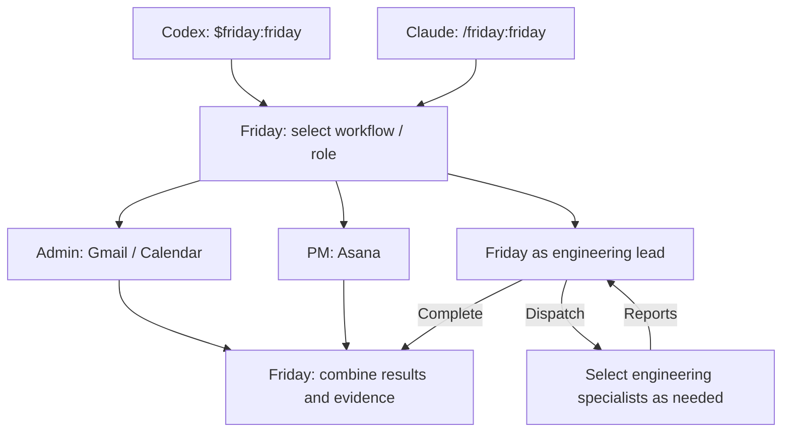
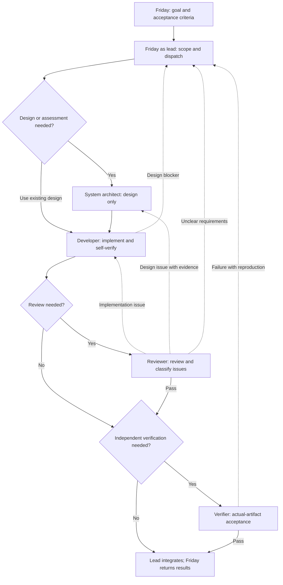

# Friday

An engineering manager's assistant team for Codex and Claude Code.

| Role | Responsibility |
|---|---|
| Administrative assistant | Gmail summaries, calendar availability, and meeting bookings |
| PM | Asana status, planning, deadlines, and blockers |
| Engineering lead | Scope, specialist delegation, correction loops, and integrated delivery |

## Install and use

Keep the checkout in a directory named `friday`; the local marketplace points to it. No build is required. Run installation commands from that directory.

### Codex

```sh
codex plugin marketplace add "$PWD"
codex plugin add friday@friday-local
```

Open a new session:

```text
$friday:friday Summarize Asana tickets for team Platform.
```

### Claude Code

```sh
claude plugin marketplace add "$PWD"
claude plugin install friday@friday-local --scope user
```

Open a new session:

```text
/friday:friday Summarize today's Gmail.
/friday:friday Fix this bug and arrange an independent review.
```

Store preferences in `~/.config/friday/profile.md`; see [profile.example.md](profile.example.md). Keep credentials out of profiles and the plugin. Service workflows verify the intended account through reads and use [connection setup](skills/friday/references/connections.md) only when access is unavailable.

## Request flow

The diagram shows logical routing. Small requests can run directly in the selected workflow; delegation is used when useful.



Skills can also run directly, such as `$friday:mail-summary` or `/friday:mail-summary`, without routing through Friday. Direct engineering delivery acts as the lead in the current context.

Both hosts share `agents/*.md` and `skills/`. Claude auto-discovers `agents/` for the plugin in `.claude-plugin/plugin.json`; Codex uses `.codex-plugin/plugin.json` and generic subagents with the role instructions. `skills/friday/team.json` is Friday's own role index, not a platform-enforced configuration. Codex does not automatically enforce Claude's `disallowedTools`; written role limits are not a filesystem sandbox. Subagents cannot delegate further, so Friday acts as the engineering lead in the main context and dispatches specialists directly; required independent checks remain pending if they cannot run.

## Engineering team

| Role | Responsibility |
|---|---|
| Lead | Plan, dispatch, manage handoffs/correction limits, and integrate evidence |
| System architect | Design systems, modules, contracts, dependencies, and data flow; no code edits |
| Developer | Investigate, implement, test, and exercise actual behavior; runs on Sonnet to save tokens |
| Reviewer | Independently review code/design and classify issues |
| Verifier | Independently check requirements against the specified actual artifact |

The implementation flow below includes optional gates. Ordinary bugs/features normally use review; architecture, cross-module, and high-risk changes use all four specialists. Independent verification is added for risk, incomplete runtime evidence, or an explicit request. Advice-only work stops at design and any requested feasibility review. Bugs, refactors, performance work, and investigations each carry required steps in the handoff (see [engineering delivery](skills/engineering-delivery/SKILL.md)). Code/project review uses reviewers only, split by module for large repositories.



Review arrows represent handoffs coordinated by the lead. The lead sends clear implementation failures straight back to the developer and asks the reviewer only when the cause is unclear; only confirmed design issues return to the architect. Reviewers and verifiers start fresh each round with only the changed range and prior findings. Repeat affected checks after changes, tied to the new revision/build. After two unsuccessful correction rounds for the same issue, stop and reassess.

The lead loads [engineering principles](skills/engineering-delivery/references/engineering-principles.md) through [engineering delivery](skills/engineering-delivery/SKILL.md) and passes applicable clauses to specialists: SOLID, purposeful abstraction/reuse, dependency injection, appropriate patterns, and avoiding overengineering. Directly invoked specialists read the principles when not supplied. Recurring defects should improve APIs, checks, or verification tools. Implementation alone does not authorize merge or deployment; no background monitoring or automerge is configured.

### Project memory

The lead resolves project paths with:

```sh
python3 /path/to/friday/skills/engineering-delivery/scripts/project_memory.py /path/to/target-repo --init
```

```text
~/.config/friday/projects/{name}-{identity-hash}/
├── memory/
│   ├── architect.md
│   ├── developer.md
│   ├── reviewer.md
│   └── verifier.md
└── tasks/
    └── {task-id}.md
```

Each specialist owns its memory. The lead owns the task record. Worktrees share a Git identity; separate clones and unrelated same-name repositories have separate state. Non-Git projects use their canonical directory. Initialization preserves existing files; omitting `--init` only prints paths. See [memory protocol](skills/engineering-delivery/references/memory.md) for overrides and handoffs.

Load relevant notes only; versioned architecture/interface documents remain in the target repo. Other resumable work uses `~/.local/share/friday/tasks/`. Existing records are not migrated or deleted, and no user state belongs in plugin caches.

## Structure

| Path | Purpose |
|---|---|
| `agents/*.md` | Role ownership, restrictions, and outputs |
| `skills/*/SKILL.md` | Workflow entry points and discovery metadata |
| `skills/friday/team.json` | Friday-owned role index with plugin-root-relative paths |
| `skills/friday/references/` | Shared team rules and connection setup |
| `skills/engineering-delivery/references/` | Engineering principles and memory protocol |
| `skills/engineering-delivery/scripts/` | Project-memory resolver and tests |
| `.agents/plugins/`, `.codex-plugin/` | Codex marketplace and plugin manifests |
| `.claude-plugin/` | Claude marketplace and plugin manifests (agents auto-discovered from `agents/`) |

## Develop and update

Follow [AGENTS.md](AGENTS.md). Update this README and [CHANGELOG.md](CHANGELOG.md) with each change. Keep both plugin versions and the role index aligned.

Memory helper tests (the only bundled script):

```sh
python3 -m unittest discover -s skills/engineering-delivery/scripts/tests -v
```

Validate manifests:

```sh
claude plugin validate .claude-plugin/plugin.json
claude plugin validate --strict .claude-plugin/marketplace.json
```

Update the host you use, then open a new session:

```sh
codex plugin add friday@friday-local
claude plugin update friday@friday-local
```

## Remove

Use the command for your host; user-owned preferences and records remain:

```sh
codex plugin remove friday@friday-local
claude plugin uninstall friday@friday-local --scope user --keep-data
```
